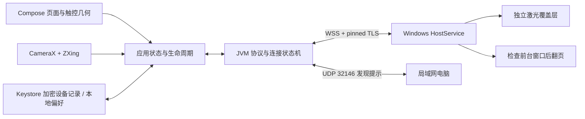

# 映点 Pointa Android 架构与实现决策

日期：2026-11-05。依据父目录的 `presentation_laser_prd_v1_0.md`、`pointa_ui_design_v5.md` 和 `pointa_ui_prototype_v5.html`。以 Windows 已实现的 [v1 协议](../../pointa-windows/docs/protocol.md) 为互通契约；HTML 中的模拟连接、页码、传感器状态不进入产品代码。

## 首版边界

Android 8.0 / API 26 以上，Kotlin、Jetpack Compose，单个 Activity。0.1.1 覆盖扫码与设备码配对、最近电脑、单手/全屏/纯翻页/空中指针、参数设置和断连安全处理。根据用户反馈，主页按剩余可用空间分配高度，不使用整页滚动；连接为无整页滚动的下拉面板，设置为全屏可滚动页面，返回栏固定。无账号、云中继、视频采集、系统鼠标模拟、自动更新或后台常驻控制服务。

## 两个模块

| 边界 | 责任 | 不承接的责任 |
| --- | --- | --- |
| `app/.../ui` | V5 页面、原位布局编辑、相对/绝对坐标、主题、无障碍描述 | 套接字、凭据、相机权限 |
| `app` 应用层 | `UiState`/`UiActions` 接线、权限、相机、持久化、音量键、进入后台停止控制 | 实现另一套协议状态机 |
| `protocol` | 发现数据校验、QR URI 解析、TLS/SRP、会话时钟、心跳、消息边界、动作反馈 | Android Context、Compose、Keystore |
| Windows 服务 | 配对批准、受信设备、单控制器、撤销、重放防护、目标屏幕信息 | 手机布局与手势 |

协议模块保留纯 JVM 边界，使 Bouncy Castle Java ↔ C# 的真实 WSS/SRP 验证无需相机、模拟器或演示文稿。界面通过回调取得真实状态；不会在点击“连接”后自行把状态改成已连接。

## 连接与信任

1. UDP 发现只提供候选 IPv4 地址，客户端以数据包源地址为准。手输 IP 可以绕开广播隔离；地址只允许数字私网或 loopback IPv4。
2. QR 先校验证书完整 DER 的 SHA-256 pin，再校验稳定 `serverId`，发送一次性 token，等待 PC 端批准。
3. 六位码只用于 certificate-bound SRP-6a。候选 TLS 是单次隔离连接，记录实际证书；只有服务端互证完成后才接受凭据。不存在明文设备码登录或全局 trust-all HTTP 客户端。
4. 已配对记录包含 serverId、证书 pin、deviceId、credential、最后地址和时间。重新连接必须同时满足证书 pin 与 serverId。凭据遭拒或证书变化回到显式配对，禁止无限重试或静默替换 pin。
5. 授权设备保存失败时应断开并提示；不能把无法保存的信任状态伪装成可再次连接。损坏数据保留，禁止静默覆盖。

协议状态为 `DISCONNECTED → CONNECTING → PAIRING → WAITING_APPROVAL → CONNECTED`；已配对设备省略配对阶段。失败进入 `FAILED`，连接代次阻止旧连接的异步回调影响新连接。

## 触控、时间与动作

- 按 2026-11-15 用户最终确认，默认进入全屏相对位移模式，从上次光点位置继续；单手使用绝对坐标。全屏仍可在设置中切为绝对映射，此时按 Windows 回报的屏幕比例留边。首次升级迁移模式默认值，保留颜色、左右手边距和信任记录；之后保存用户选择。
- 左右手独立保存四边边距；宽至少保留原容器 42%，高至少 40%。相邻触控边距改变翻页侧栏宽度。0.1.2 在原控制工作区直接拖拽，编辑前后工作区尺寸不变，立即更新布局、200 ms 合并写入偏好；恢复默认也自动保存，不再提供边距数值弹窗或保存/取消草稿。
- 输入点只保留最新值，协议发送约 60 Hz。抬起、取消、切换页面/模式和后台切换清空待发点并隐藏激光。
- 每次主动翻页生成新的 UUID；客户端遵守 180 ms 冷却，服务端仍执行独立校验。断连后不补发触控或翻页。有效点击调用系统振动器，不设偏好开关；失败通过不重放的 SharedFlow 通知前台 Activity，取消旧 Toast 后显示短 Toast，离开前台时取消，不写入常驻 statusError。
- 心跳约 1 秒，控制消息携带递增序列与校正后的服务器时间；间隔计算使用单调时钟。Windows 超时上界约 4 秒，不描述为断网瞬间检测。
- 激光颜色直接由主题索引计算，连接成功和主题变更时发送；忽略旧偏好中的独立颜色与触觉开关。黑色主题对应黑色激光。大小/拖尾/平滑仍接受服务器确认，修改合并 300 ms 发送以满足每秒四次限制。
- `session.ready` 和 `heartbeat.ack` 中的 `display` 为真实选中屏幕宽高或 `null`。Windows 屏幕切换/热插拔后的心跳更新比例，旧客户端可忽略这个 v1 新增字段。
- 空中指针按住时才注册 `TYPE_GAME_ROTATION_VECTOR`，依次回退旋转向量、重力、加速度传感器。0.1.2 按参考网页以手机上边缘为指向轴，投影到校准时的三轴基底，采用 80 ms 时间低通、0.1° 连续死区和 25° 归一化范围；倾斜模式另用 beta/gamma 差值。松手、后台、导航、断连都注销监听。超过 250 ms 的旧样本丢弃，500 ms 无更新停止输出。松手后重新按住保留位置，归零或屏幕方向变化恢复中心；它是角位移映射，不是屏幕空间定位。详见 [参考算法对齐](reference-alignment.md)。

启动、切回前台、网络变化和失败均不自动连接。用户点击最近电脑时，执行一次有界发现以刷新其地址，再尝试一次连接；失败后等待下一次明确点击。旧偏好中的 autoReconnect 字段被忽略并不再保存。

## 本地数据与发行

设备密钥使用 Android Keystore，设备记录用 AES-256-GCM 加密；普通 UI 偏好独立存放。应用禁止系统备份和设备迁移导出信任记录，扫码帧只在内存解码。权限、数据生命周期见 [隐私与安全](privacy-security.md)。

开发版输出 APK；正式签名、应用商店、兼容机型和低延迟指标须在发布验收后确认。测试与待完成门槛见 [validation.md](validation.md)，功能与阶段取舍见 [scope.md](scope.md)。
